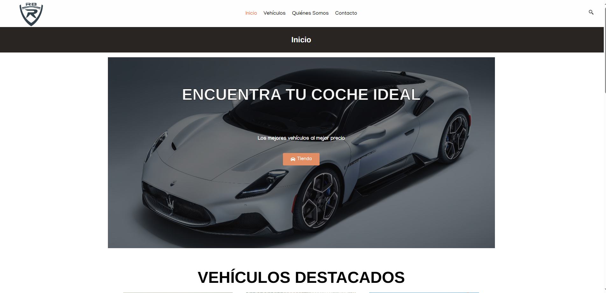
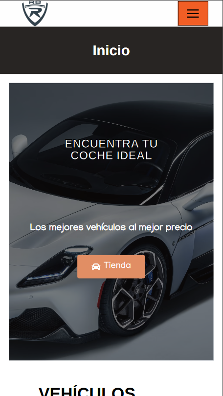

# RbCoches

Web de concesionario de vehículos creada con WordPress, Elementor y WooCommerce.

🎥 https://youtu.be/9V9CuHKkKF4?si=Da_dtV6ihXua5gMw

> Proyecto de demostración realizado en entorno local (XAMPP). No contiene servidor en activo.

> El contenido de WordPress está en su base de datos, no en archivos. Por eso el repositorio incluye solo el CSS propio, capturas y el vídeo de demostración.

  PORTADA
 

  PORTADA EN FORMATO MOVIL
 

¿ Qué incluye la web?
- Página de inicio con vehículos destacados, testimonios y motivos para elegir esa empresa
- Catálogo con ordenación y ficha de cada vehículo
- Formulario de contacto, "Quiénes somos" y métodos de contacto

💻 Tecnologías
WordPress · Elementor · WooCommerce · Contact Form 7 · Yoast SEO · CSS personalizado

CSS personalizado
Los ajustes de estilo propios están en [`Css/custom.css`](Css/custom.css).
